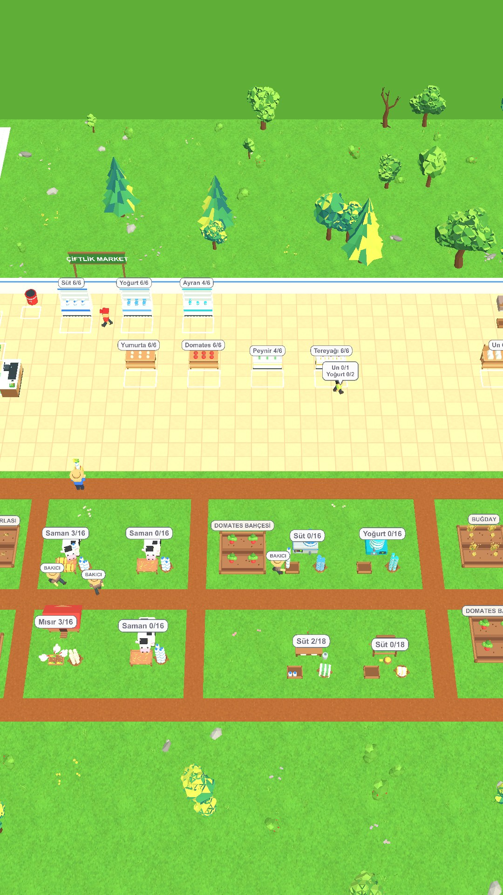
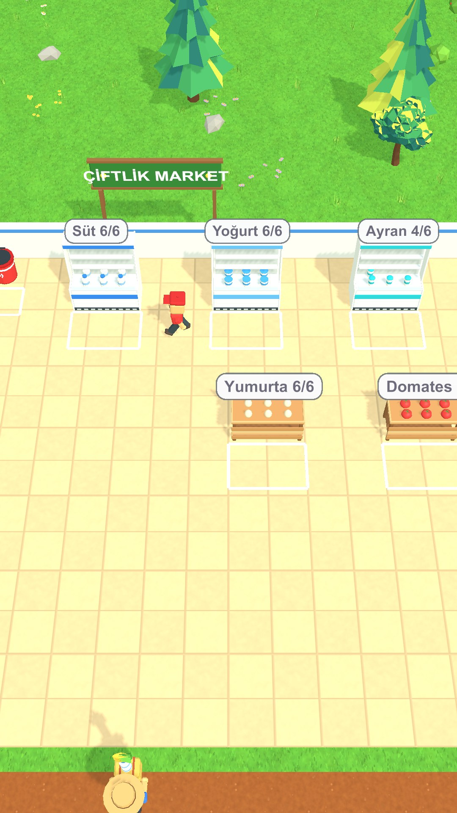
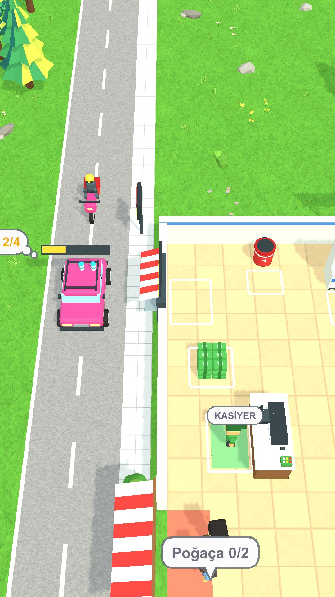
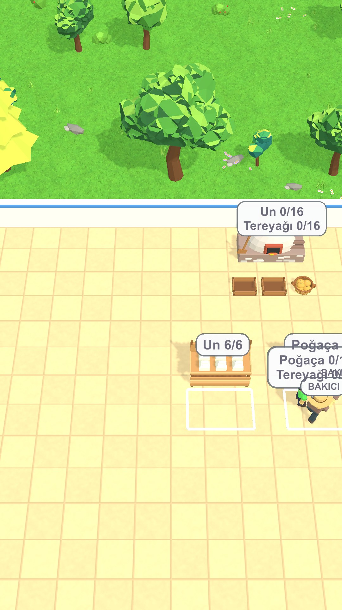
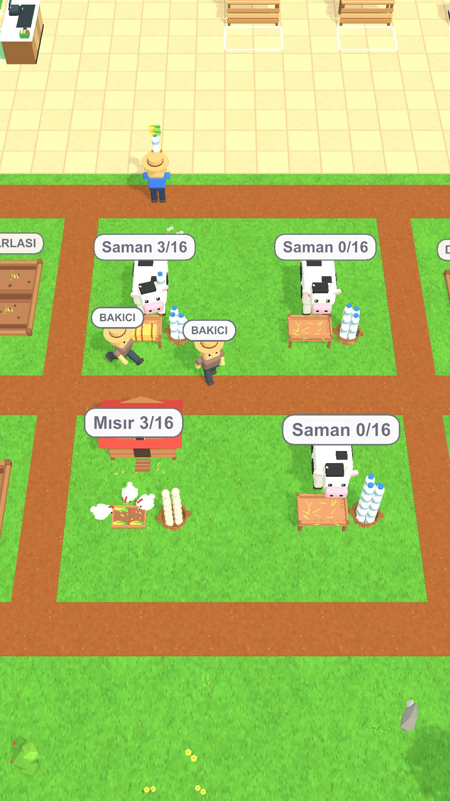
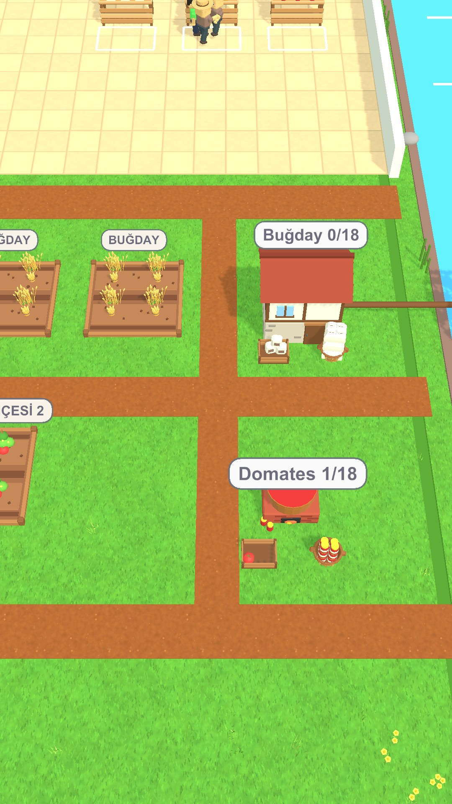
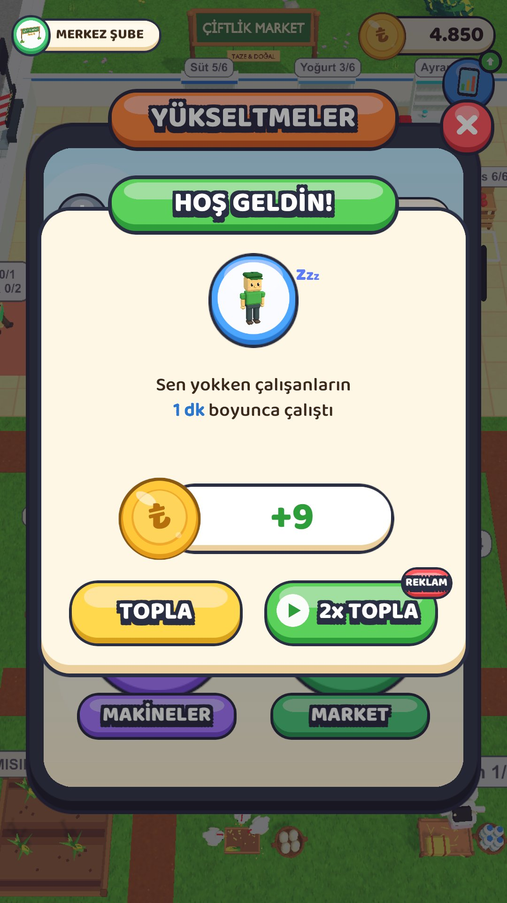

# Tillmart: Tarladan Rafa 🌾🛒



Unity ile geliştirilmiş, Android için 3D bir **çiftlik ve market işletme** oyunu. Tarlada ürün yetiştir, hayvanlarını besle, makinelerde işle, ürünleri kendi marketinin raflarına diz ve müşterilere sat. Kazancınla çalışan tut, makineleri yükselt ve yeni şubeler aç!

## Özellikler

- **Tarlalar:** Buğday, mısır, domates ve saman yetiştirme
- **Hayvanlar:** İnek ve tavuk besleme; süt ve yumurta toplama
- **Üretim makineleri:** Değirmen, fırın, mandıra; yoğurt, ayran, peynir, tereyağı, un gibi ürünler
- **Market işletmesi:** Rafları doldurma, kasada satış, müşteri akışı ve yoğun saatler (rush hour)
- **Drive-thru:** Arabayla gelen müşterilere servis
- **Çalışanlar:** Bakıcı ve taşıyıcı işe alma, otomatik üretim
- **Şubeler:** Merkez şubeden Karadeniz gibi yeni bölgelere genişleme
- **Yükseltmeler, günlük ödüller, görevler** ve çevrim dışı kazanç
- Toptancı satışı, öğretici (tutorial) ve dokunsal geri bildirim (haptics)

## Ekran Görüntüleri

| | | |
|---|---|---|
|  |  |  |
|  |  |  |

## Teknik Bilgiler

- **Motor:** Unity 6 (6000.5.1f1), Universal Render Pipeline (URP)
- **Dil:** C#
- **Platform:** Android
- **Navigasyon:** NavMesh tabanlı müşteri ve çalışan hareketi

## Proje Yapısı

```
Assets/CiftlikMarket/
├── Scripts/     # Oyun kodları (GameManager, Customer, Worker, Shelf, DriveThru, BranchManager...)
├── Editor/      # Sahneyi kuran editör araçları (PrototypeBuilder*)
├── Prefabs/     # Ürün, makine, karakter prefabları
├── Models/      # 3D modeller ve meshler
├── Materials/   # Materyaller
├── Resources/   # Çalışma anında yüklenen içerikler
└── Shaders/     # Özel shader'lar
Assets/Scenes/Prototype.unity   # Ana oyun sahnesi
```

## Kurulum

1. Depoyu klonlayın: `git clone https://github.com/ibrahim688-ker/Tillmart.git`
2. Unity Hub'dan **Unity 6000.5.1f1** (veya uyumlu bir Unity 6 sürümü) ile projeyi açın.
3. `Assets/Scenes/Prototype.unity` sahnesini açıp **Play**'e basın.

## Kullanılan Hazır Varlıklar

Bazı 3D modeller ücretsiz (CC0) paketlerden alınmıştır: Kenney *Food Kit*, Quaternius *Crops* ve *Farm Animals*.
